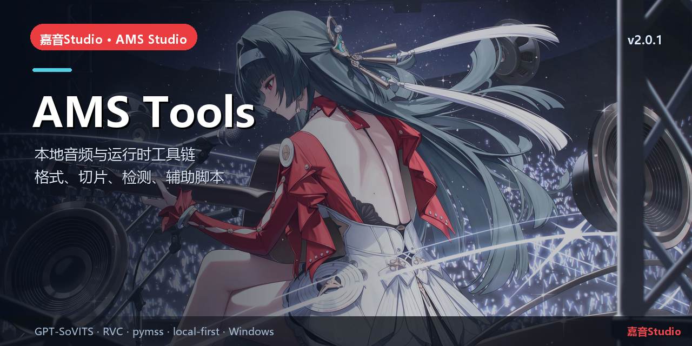

# AMS Tools

> MSVC/XINYU_AI → RVC pth 等本地转换工具


## 简介

嘉音Studio 的本地工具链仓库。当前主要提供 **MSVC/XINYU_AI → RVC v2 pth** 转换、校准缓存与校验脚本，
供 Gateway 的 `convert.msvc` 任务与手动工具使用。

## 核心能力

- `msvc2pth.py`：容器模型转 RVC v2 pth。
- `calibration_cache.json`、`build_cache.py`、`verify_rvc.py`：构建/校验辅助。
- CI：`.github/workflows/ci.yml`。

## 本仓库

```text
msvc2pth/  转换脚本、缓存、校验
```

## 快速开始

```powershell
python msvc2pth\msvc2pth.py --help
```

## 相关链接

- 总仓库：[yan-mc/AMS-Studio](https://github.com/yan-mc/AMS-Studio)
- 最新发布：[yan-mc/ams-release releases](https://github.com/yan-mc/ams-release/releases)
- 当前版本：**嘉音Studio v2.0.1**（feed 2058）
- 文档：[ams-docs](https://github.com/yan-mc/ams-docs)

## 说明

- 所有音乐数据默认留在安装目录 `data/`；Gateway 只监听 `127.0.0.1`。
- 本项目为本地优先工具，不提供云端上传；使用第三方模型/音频时请遵守各自许可。
- License: 项目自有代码按仓库声明；第三方格式/工具遵循各自许可证。
